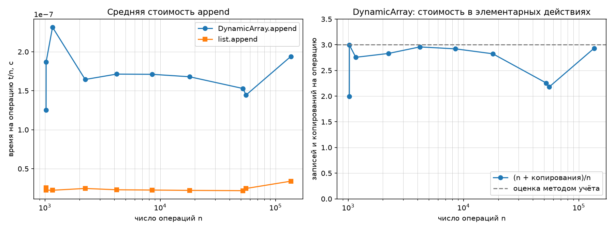
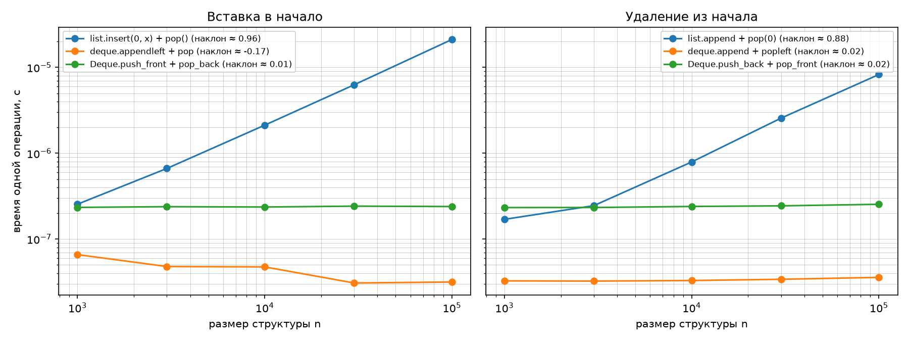

# Лабораторная работа №2 — рекурсия и линейные структуры данных

**Дисциплина:** Структуры данных и алгоритмы  
**Тема:** Реализация рекурсивных функций и динамического массива, стека и дека  
**Вариант:** 1 (использован в предыдущих запусках; необходимо сверить с `data/generated/manifest.json`)  
**Язык:** Python 3.12 (требование КИМ: Python 3.10+)  
**Основа отчёта:** предоставленный исходный код, результаты встроенной проверки на контрольных операциях и два предоставленных графика.

> **Статус проверки:** шесть разделов `self_check` прошли на небольшой контрольной последовательности, включая случайные тесты из заготовки. Запуск на *полных* файлах `ops_stack.txt` и `ops_deque.txt` варианта 1 в этой проверке не проводился: эти файлы не были предоставлены. В таблицах ниже приведены подтверждённые счётчики рекурсии; реальные значения времени и `copies` по размерам варианта нужно взять из своего вывода программы. Изображения графиков предоставлены автором работы.

## 1. Цель

Реализовать рекурсивные алгоритмы, динамический массив с ручным ростом ёмкости ×2, стек на его основе и дек на двусвязном списке. Проверить корректность, оценить временную и пространственную сложность, показать амортизированную стоимость `append`, сравнить свои структуры со стандартными.

## 2. Подготовка данных и запуск

Команды выполнять **из корня** `data-structures-and-algorithms`:

```powershell
python -m pip install -r requirements.txt
python scripts/generate_data.py --variant 1 --only ops
python M1-intro-and-basic-structures/attachments/lab02-recursion-structures-starter.py --variant 1 --data data/generated
```

Генератор использует `seed = 30 + N`, поэтому для варианта 1 `seed = 31`. Данные включают размеры серий `append` и по 100 000 операций стека и дека (согласно КИМ). Соответствие варианта проверяется по `manifest.json`.

Программа печатает результаты тестов, счётчики вызовов, замеры операций и сохраняет `lab02_append.png`, `lab02_front.png` в текущий каталог (либо в каталог, заданный `--out`).

## 3. Реализованные рекурсивные алгоритмы

### 3.1. Факториал

Для `n ≥ 0`: `0! = 1`, `n! = n · (n−1)!` при `n > 0`. База: `n <= 1`; переход: `n * factorial(n-1)`. Время **O(n)**, глубина стека и дополнительная память **O(n)**. Для отрицательных `n` в текущем коде нет явной проверки; контракт предусматривает неотрицательные входы.

### 3.2. Числа Фибоначчи

`F(0)=0`, `F(1)=1`, `F(n)=F(n−1)+F(n−2)`.

- **Наивный алгоритм:** вычисляет одинаковые подзадачи повторно. Рекуррентное соотношение для времени `T(n)=T(n−1)+T(n−2)+O(1)`; время **Θ(φ^n)**, где `φ≈1,618`, стек **O(n)**.
- **Мемоизация:** словарь `memo` хранит уже найденные значения, передаётся в оба рекурсивных вызова. Время **O(n)**, память **O(n)** (словарь плюс стек). Счётчик учитывает также вызовы, вернувшие результат из словаря.

**Таблица 1. Точные числа вызовов для представленной реализации (счётчик сбрасывается перед каждым n).**

| n | F(n) | `fib_naive` | `fib_memo` |
|---:|---:|---:|---:|
| 5 | 5 | 15 | 9 |
| 10 | 55 | 177 | 19 |
| 15 | 610 | 1 973 | 29 |
| 20 | 6 765 | 21 891 | 39 |
| 25 | 75 025 | 242 785 | 49 |
| 30 | 832 040 | 2 692 537 | 59 |

Для `n ≥ 2` в данном коде `C_naive(n) = 2F(n+1) − 1`, `C_memo(n) = 2n − 1`. Для `n=0,1` обе функции вызываются один раз. Например, при `n=30` наивная версия совершает примерно **45 636** раз больше вызовов (2 692 537 / 59).

### 3.3. Ханойские башни

База: при `n=0` ходов нет. Переход: перенести `n−1` дисков на вспомогательный стержень, переместить оставшийся диск на целевой, перенести `n−1` дисков на целевой. `T(n)=2T(n−1)+1`; **число перемещений `2^n−1`**, время **Θ(2^n)**. Глубина рекурсии **O(n)**. Если сохранять все ходы в `moves`, объём результата **Θ(2^n)**. Самопроверка проигрывает каждый ход, не допускает перенос с пустого стержня и размещение большого диска на меньшем, контролирует конечное состояние.

## 4. Собственные линейные структуры

### 4.1. `DynamicArray`

Внутри хранятся `_buffer` фиксированной длины, `_size` и `_capacity`. Начальная ёмкость равна 4. При заполнении создаётся новый буфер длиной `2 * capacity`, существующие элементы копируются, `copies` увеличивается на число переносов. Прямое использование `list.append`, `insert`, `pop` для внутреннего буфера отсутствует. Сжатие после `pop` не реализовано, что допускается заданием.

**Инварианты:** `0 ≤ _size ≤ _capacity`, `len(_buffer) == _capacity`; при последовательных добавлениях ёмкость меняется только при заполнении и удваивается. Реализованы `append`, `pop`, `get`, `set`, `len`. В `pop` ссылка в освобождённой ячейке очищается (`None`). Для пустого `pop` и индексов вне диапазона выбрасывается `IndexError`.

### 4.2. `Stack`

Стек реализован только через публичные методы `DynamicArray`: `push → append`, `pop → pop`, `peek → get(len−1)`. Принцип **LIFO**: последним добавлен — первым извлечён. `push` — амортизированно **O(1)**; `pop`, `peek`, `len` — **O(1)**. `pop` или `peek` пустого стека вызывает `IndexError`.

### 4.3. `Deque`

Дек реализован двусвязными узлами `_Node(value, prev, next)` и указателями `_head`, `_tail`; хранится `_size`. Поддерживаются `push_front`, `push_back`, `pop_front`, `pop_back`, `len`. **Каждая операция с концом O(1)** в худшем случае при наличии указателей на оба конца. При удалении последнего элемента оба указателя устанавливаются в `None`. При удалении с одного конца соответствующая внешняя ссылка соседнего узла обнуляется. Дек поддерживает FIFO (добавление с одного конца, удаление с другого) и LIFO (добавление и удаление с одного конца).

## 5. Сложности операций

| Операция | Сложность | Почему |
|---|---|---|
| `factorial(n)` | время O(n), стек O(n) | n вложенных вызовов |
| `fib_naive(n)` | время Θ(φ^n), стек O(n) | повторный пересчёт ветвей |
| `fib_memo(n)` | время и память O(n) | каждая подзадача вычисляется один раз |
| `hanoi(n)` | время Θ(2^n), стек O(n) | `2^n−1` ходов; с сохранением ходов память Θ(2^n) |
| `DynamicArray.append` | амортизированно O(1), иногда O(n) | копирование при расширении |
| `DynamicArray.pop/get/set` | O(1) | работа по известному индексу/концу без сжатия |
| `Stack.push` | амортизированно O(1) | делегирует `append` |
| `Stack.pop/peek` | O(1) | операция с последним элементом |
| `Deque.push_front/push_back` | O(1) | изменяется постоянное число ссылок |
| `Deque.pop_front/pop_back` | O(1) | изменяется постоянное число ссылок |
| `list.insert(0,x)` / `list.pop(0)` | O(n) | сдвиг элементов массива |
| `collections.deque.appendleft/popleft` | O(1) | операции на концах дека |

## 6. Амортизированный анализ `append` банковским методом

Единичная стоимость обычного `append` — 1 запись. При переполнении буфера ёмкости `c` стоимость — `c` копирований плюс 1 запись; отдельная операция может стоить **Θ(n)**.

Назначим каждой операции **3 условные единицы**: 1 оплачивает запись нового элемента; 2 откладываются как кредит на будущее расширение. После увеличения ёмкости с `c/2` до `c` до следующего переполнения выполняется `c/2` обычных добавлений (считая добавление, заполнившее буфер). Они создают `2 · (c/2) = c` единиц кредита, достаточных для копирования `c` элементов при следующем расширении. Начальный буфер ёмкости 4 не требует дополнительного кредита: первые 4 операции накапливают 8 единиц, при первом расширении копируются 4 элемента. Таким образом, банк не уходит в минус.

При `n` добавлениях все копирования составляют геометрическую сумму `4 + 8 + 16 + ... < 2n`. Полная цена в элементарных действиях `n + copies < 3n`; на один `append` приходится **меньше 3** действий в среднем. Следовательно, **амортизированная стоимость O(1)**, хотя не каждый отдельный вызов O(1).

При переходе от `n=2^k` к `n=2^k+1` требуется новое расширение; скачок `copies` примерно на `2^k` вызывает заметный рост `(n+copies)/n` почти на 1. Далее величина постепенно снижается до следующей границы роста. Это видно на графике. Здесь считаются только записи и копирования элементов, не все инструкции Python.

## 7. Эксперимент и графики

**Методика:** каждый замер выполняется с прогревом, затем 5 повторов; используется медиана `time.perf_counter`. Для серий `append` время делится на число операций. Для эксперимента с началом структур применяются `n=1000, 3000, 10000, 30000, 100000`, по 1000 пар добавления/удаления для каждой точки. Графики у начала построены в логарифмических осях.



*Рис. 1.* На предоставленном графике `DynamicArray.append` дороже встроенного `list.append` по постоянному коэффициенту, но среднее время на операцию не растёт линейно с `n`. Стоимость `(n + copies)/n` остаётся ниже 3, как и предсказывает банковский метод; видны колебания на границах увеличения буфера.



*Рис. 2.* На графике для `list.insert(0,x) + pop()` измеренный наклон около **0,96**, для `list.append + pop(0)` около **0,88**, то есть близко к ожидаемому 1. У стандартного `collections.deque` и собственного `Deque` наклоны близки к 0 (на одном графике для стандартного дека оценка около −0,17 из-за шума очень коротких замеров), что соответствует O(1). Собственный дек медленнее стандартного по постоянному множителю, поскольку узлы и методы реализованы на Python, а не оптимизированы на уровне C. Наклон графика — экспериментальная оценка, а не математическое доказательство сложности.

**Замечание к методике:** фактически сравниваются пары операций при практически постоянной длине структуры, чтобы один и тот же размер повторялся много раз. Затраты в паре обусловлены прежде всего исследуемой операцией у начала; второе действие поддерживает постоянный размер. Численные времена и множители зависят от оборудования и нагрузки.

**Результаты на данных своего варианта:** исходный вывод консоли с числами `copies`, временем операций из `ops_stack.txt` и `ops_deque.txt` в предоставленных материалах отсутствует. Для окончательной сдачи вставить сюда реальные строки вывода соответствующего запуска; не подменять их оценками с графиков.

## 8. Верификация, тестирование и инварианты

Встроенный `self_check` в коде проверяет:

1. `factorial` сравнением с `math.factorial`; Фибоначчи — сравнением с табличными значениями, число вызовов — счётчиками; Ханойские башни — проигрыванием допустимых ходов.
2. Динамический массив — границы 4/8/16/32/64, корректность `capacity` и `copies`, `get/set`, удаление до пустоты, повторное заполнение.
3. Стек — `push/peek/pop` по LIFO, ошибки на пустом стеке, случайные операции со сравнением с `list`.
4. Дек — все комбинации добавления, удаления и повторного заполнения одного элемента, сравнение с `collections.deque` на случайной серии.
5. Операции варианта — сверку каждого результата и длины со стандартными эталонами (при наличии файлов данных).
6. **Дополнительную функцию `check_invariants`:** проверяет для массива `0 ≤ size ≤ capacity` и длину буфера; для стека — размер и порядок LIFO; для дека — согласованность `_head/_tail`, отсутствие внешних ссылок, обратные ссылки между соседями, достижимость хвоста и точное число узлов. Для собственных проверок используется `expect`, который выбрасывает `SelfCheckError`, а не `assert`, поэтому проверки сохраняются с `python -O`.

**Проверка предоставленного файла:** выполнение `self_check` на контрольных сериях прошло с результатом `OK` по всем шести разделам. Проверка на исходных 100 000 операциях конкретного варианта должна быть повторена локально.

**Дополнительные пограничные случаи:** неотрицательные аргументы рекурсивных функций; пустые структуры; одноэлементная структура; `pop` до нуля; повторное заполнение; отрицательные индексы; пересечение границы удвоения ёмкости.

## 9. Выводы

1. Наивная рекурсия для Фибоначчи многократно пересчитывает одни и те же значения: для `n=30` — 2 692 537 вызовов против 59 с мемоизацией. Хранение результатов снижает сложность с экспоненциальной до линейной.
2. `DynamicArray.append` имеет амортизированную стоимость O(1) при росте ×2. Метод учёта даёт верхнюю оценку менее 3 элементарных записей/копирований на добавление в рассматриваемой модели.
3. Для вставки и удаления у начала `list` требуется O(n), поскольку сдвигаются элементы. Дек со ссылками на голову и хвост выполняет операции концов за O(1), но платит за дополнительные ссылки, выделения памяти и менее компактное хранение.
4. Проверка инвариантов и сравнение с эталонами помогают обнаружить ошибки не только в значениях, но и в состоянии структуры после повторных операций.
5. Экспериментальные графики качественно подтверждают теоретические оценки. Для полной воспроизводимости необходимо сохранить результаты запуска на данных собственного варианта и состояние среды.

## 10. Что проверить перед отправкой

- [ ] Запускать именно свой номер варианта, проверить `manifest.json` (вариант 1 → seed 31).
- [ ] Получить `self_check: OK` при чтении полных файлов варианта, сохранить лог запуска.
- [ ] Подставить конкретные числа `copies` и время по операциям своего варианта из консоли в раздел 7.
- [ ] Положить `README.md`, `.py`, `lab02_append.png`, `lab02_front.png` в личный репозиторий с корректными относительными ссылками.
- [ ] При необходимости удалить оставшиеся `TODO` из комментариев и заменить их описаниями сложности (сама реализация на этих местах написана).
- [ ] Запустить форматирование и стиль-проверку по правилам курса (`black`, `pylint`, если установлены), осмысленно зафиксировать изменения коммитами.
- [ ] Для защиты изучить файл `ВОПРОСЫ_К_ЗАЩИТЕ.md` и уметь объяснить собственный код.
